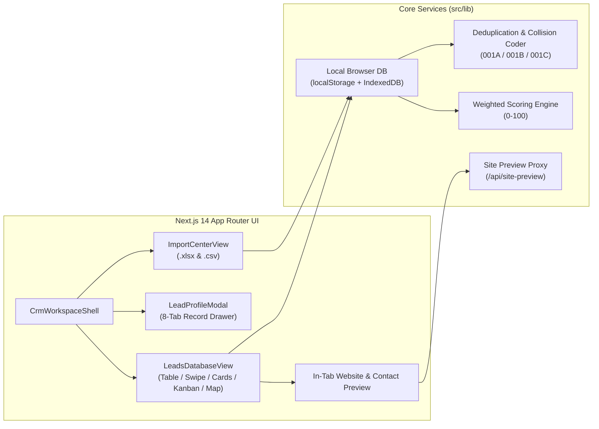

# Jayant CRM

**Jayant CRM** is a lead intelligence and relationship management workspace built for **Jayant Web & AI Systems**. It combines spreadsheet-speed lead triage with structured collections, daily spreadsheet tracking, in-tab website previews, and outreach tracking.

---

## Key Features

### 1. All Leads & Qualified Leads Views
- **Workspace Sidebar Navigation**: Dedicated **All Leads** and **Qualified Leads** sections with live record counts.
- **1-Click Qualification**: Qualify or unqualify any lead from the table, cards, swipe deck, or pipeline dropdown. Qualifying a lead automatically synchronizes its qualification decision (`qualified`), outreach approval (`approved`), and pipeline stage (`Qualified`).
- **Flexible Pagination**: View **50**, **100**, or **Unlimited** records per page across all long lists (All Leads, Qualified Leads, Contacts, Suppression Registry, and Activity Timeline).

### 2. Daily Spreadsheets & Sequential Numbering (`001` → `∞`)
- **Daily Spreadsheet Selector**: Group imported spreadsheets by day (`Day #001`, `Day #002`, ...) or view all days together.
- **Sequential Numbering**: Every lead, daily batch, and category is numbered sequentially (`001`, `002`, `003`, ...) using tabular numerals.
- **In-Place Category Storage**: Create categories inside the Leads view and assign single or bulk-selected leads to any category.

### 3. Duplicate Erasure & Number Collision Coding (`001A`, `001B`, `001C`)
- **Exact Duplicate Removal**: The built-in deduplication script detects leads with identical content (matching normalized domain + organization name + contact details) and removes the duplicate rows.
- **Number Collision Disambiguation**: When two distinct leads share the same sequence number (`001`) but have different company names or details, both records are kept and assigned alphabetic suffix codes (`001A`, `001B`, `001C`, ..., `001Z`, `001AA`).

### 4. Five Interactive Lead Views
- **Table View**: High-density spreadsheet table with inline stage, qualification, and category selectors, bulk actions, and customizable columns.
- **Swipe Deck View**: Centered card triage mode for reviewing leads one by one (`Pass`, `Qualify & Approve`, `Message Sent`, `Follow-up`, `Replied`, and `Bookmark`).
- **Cards Grid**: Visual card layout with quick outreach and qualification actions.
- **Kanban Board**: Stage-by-stage pipeline board (`New`, `Reviewed`, `Qualified`, `Contacted`, `Proposal`, `Won`, `Lost`).
- **Geography View**: Lead distribution grouped by country and market (`India` vs. `International`).

### 5. In-Tab Website & Contact Page Preview
- Every lead resolves both a **Website Page** and a **Contact Page** URL.
- Clicking **Website** or **Contact** opens an in-tab split preview (with a proxied live site reader and extracted contact paths) so you can inspect sites without leaving the CRM tab.

### 6. Outreach Operations & Design Inspirations
- **Quick Message Operations**: Log outreach states (`Not Messaged` → `Message Sent` → `Follow-up Sent` → `Replied`) with a single click from any view.
- **Design Inspirations Library**: Bookmark any lead's website into the **Design Inspirations** library (`References & Content`) for future design reference.

### 7. Zero Dummy Data & Local-First Storage
- **No Pre-Filled Dummy Data**: Starts with a clean workspace ready for your real `.xlsx` and `.csv` spreadsheets.
- **100% Local Browser Persistence**: Stores workspace state in `localStorage` and `IndexedDB` out of the box, with full `.xlsx`, `.csv`, and `.json` workspace backup and restore.
- **Optional PostgreSQL Backend**: Includes a complete Drizzle ORM schema (`src/db/schema.ts`) supporting external PostgreSQL (`DATABASE_URL`) or embedded PGlite (`@electric-sql/pglite`).

---

## Architecture Overview



---

## Tech Stack & Typography System

| Layer | Technology |
| :--- | :--- |
| **Framework** | Next.js 14 (App Router), React 18, TypeScript |
| **Styling** | Tailwind CSS + CSS custom properties (Dark `#0B0D12` & Light themes) |
| **Typography** | `next/font/google`: **Inter** (UI, tables, forms, buttons), **Manrope** (page titles, collection headings, KPI metrics), **IBM Plex Mono** (IDs, domains, sequence codes with `tabular-nums`) |
| **Spreadsheets** | `ExcelJS` (multi-sheet `.xlsx` import/export) + `PapaParse` (`.csv` import/export with formula-injection sanitization) |
| **Domain Parsing** | `tldts` (ICANN & multi-tenant public suffix normalization) |
| **Storage / DB** | Browser `localStorage` + `IndexedDB` by default; Drizzle ORM + PostgreSQL / PGlite (`src/db/schema.ts`) |
| **Testing** | Vitest (`src/__tests__/crm-core.test.ts`) |

---

## Getting Started

### Prerequisites
- Node.js `>= 18.18.0`
- npm `>= 9.0.0`

### 1. Install Dependencies
```bash
npm install
```

### 2. Start the Development Server
```bash
npm run dev
```
Open [http://localhost:3000](http://localhost:3000) in your browser.

### 3. Optional Environment Variables
If you want to connect an external PostgreSQL database or customize operator credentials, copy `.env.example` to `.env`:
```bash
cp .env.example .env
```

| Variable | Description | Default |
| :--- | :--- | :--- |
| `DATABASE_URL` | Optional PostgreSQL / Supabase connection URI | *(Local persistence)* |
| `PGLITE_DATA_DIR` | Directory for local embedded PostgreSQL data | `./data/pgdata` |
| `CRM_ADMIN_EMAIL` | Operator login email | `jayant@jayant.systems` |
| `CRM_ADMIN_PASSWORD` | Operator login password | `jayant-crm-2026` |
| `CRM_SESSION_SECRET` | HMAC-SHA256 secret for session cookies | *(Built-in dev secret)* |

---

## Scripts & Testing

| Command | Description |
| :--- | :--- |
| `npm run dev` | Start the Next.js development server on port `3000` |
| `npm run build` | Build the production Next.js bundle |
| `npm start` | Run the production server |
| `npm run lint` | Run TypeScript type checking (`tsc --noEmit`) |
| `npm test` | Run the Vitest test suite (`crm-core.test.ts`) |

---

## Project Structure

```text
├── src/
│   ├── app/
│   │   ├── api/
│   │   │   ├── auth/           # Session authentication route
│   │   │   ├── export/         # CSV, XLSX, and JSON export endpoint
│   │   │   ├── import/         # Multi-sheet spreadsheet inspection & import
│   │   │   ├── site-preview/   # In-tab website & contact page proxy
│   │   │   └── workspace/      # Workspace state & mutation API
│   │   ├── globals.css         # Theme variables & typography rules
│   │   ├── layout.tsx          # Inter, Manrope & IBM Plex Mono font setup
│   │   └── page.tsx            # Root workspace entry
│   ├── components/
│   │   ├── CrmWorkspaceShell.tsx       # Sidebar navigation, dashboard & command palette
│   │   ├── LeadsDatabaseView.tsx       # All Leads / Qualified Leads (Table, Swipe, Cards, Kanban, Map)
│   │   ├── LeadProfileModal.tsx        # 8-tab lead profile drawer & in-tab site preview
│   │   ├── ImportCenterView.tsx        # Multi-sheet .xlsx / .csv import wizard
│   │   ├── CollectionSettingsView.tsx  # Custom collections, fields & scoring rules
│   │   └── WorkflowAndLibraryViews.tsx # Pipelines, tasks, contacts, inspirations & analytics
│   ├── db/
│   │   ├── index.ts            # Drizzle ORM / PGlite / pg connection
│   │   └── schema.ts           # Relational schema definitions
│   ├── lib/
│   │   ├── browser-storage.ts  # Local browser DB, pagination, deduplication & 001A/B/C coding
│   │   ├── crm-service.ts      # Server-side CRM queries & mutations
│   │   ├── domain-utils.ts     # Domain normalization, URL validation & sequence suffix helpers
│   │   ├── scoring.ts          # Weighted 0-100 lead scoring engine
│   │   └── spreadsheet.ts      # ExcelJS & PapaParse multi-sheet parser/exporter
│   └── __tests__/
│       └── crm-core.test.ts    # Unit & end-to-end workflow tests
└── package.json
```
